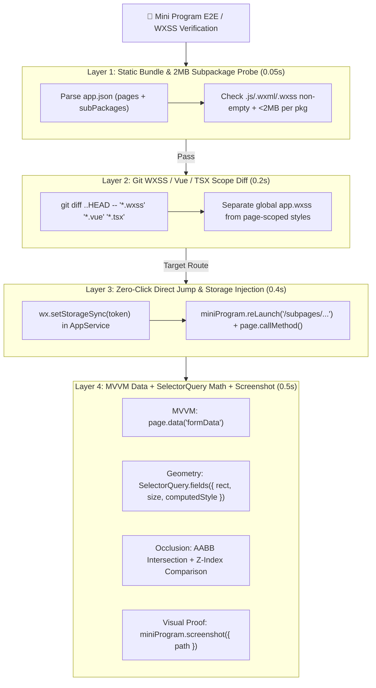

# ⚡ fast-mp-inspector

> **"Stop making your AI agent tap through 5 TabBars and dump 10,000-line WXML trees. Verify WeChat Mini Programs in 1 second with subpackage probes, AppService `page.data()`, `SelectorQuery` geometry math, and instant simulator screenshots."**
>
> **专为微信小程序（原生 / uni-app / Taro）打造的零点击极速 E2E、MVVM 数据与 WXSS 几何/遮挡断言 Agent Skill —— 支持模拟器一键截图与无界面数学级校验。**

[](./SKILL.md)
[](https://developers.weixin.qq.com/miniprogram/dev/devtools/auto/)
[](#)
[](./LICENSE)

---

## 🧐 Why Another Mini-Program Tool? How Does It Differ from Existing Open-Source MCPs?
## 与现有开源小程序 MCP / Skill 的核心区别

We surveyed the leading open-source WeChat Mini Program AI tools on GitHub (`DoraemonHugU/miniprogram-browser`, `WaterTian/wechat-devtools-mcp`, `mileson/weapp-devtools-mcp`, and `Chaixueyuan/weapp-agent-mcp`). While they successfully bridge WeChat DevTools to AI agents, they focus on **interactive step-by-step UI clicking and WXML tree snapshots**.

`fast-mp-inspector` takes a fundamentally different **"Short-Circuit + Dual-Thread Math"** approach:

| Feature / Dimension | `wechat-devtools-mcp` / `weapp-agent-mcp` | `miniprogram-browser` | ⚡ **`fast-mp-inspector` (This Repo)** |
| :--- | :--- | :--- | :--- |
| **Architecture** | Long-running MCP Server (30+ granular tools) | Agent-Browser style step-by-step CLI | **4-Layer Short-Circuit CLI + Skill** (Single-shot JSON report) |
| **White-Screen & Subpackage Limit Probe** | ❌ Launches DevTools and waits for timeout | ❌ Requires running DevTools session | ✅ **`check-mp-bundle.mjs` (0.05s)**: Validates `app.json` routes, `.wxml/.wxss/.js` integrity & **2MB subpackage limit** *before* touching DevTools |
| **Dual-Thread Awareness (`AppService` vs `WebView`)** | Dumps raw WXML nodes into LLM context | Navigates & snapshots element refs | ✅ **Single-IPC `NodesRef.fields()`**: Queries `rect`, `size`, and `computedStyle` in one AppService round-trip |
| **Layout & `rpx`/`px` Width Verification** | Eyeballs simulator screenshots | Manual element inspection | ✅ **Mathematical `px` & `rpx` Gap Assertions**: Automatically computes `leftGapPx`, `rightGapPx`, `leftGapRpx`, and `horizontalFillRatio` |
| **Z-Index & Fixed-Bar Occlusion Detection** | ❌ Misses covered buttons (`element` still exists in WXML) | ❌ No overlap math | ✅ **AABB + `z-index` Collision Math**: Detects when `.fixed-footer`, `.custom-nav`, or `.sticky-col` covers a target element |
| **MVVM State Verification** | Scrapes rendered WXML text | Scrapes rendered WXML text | ✅ **Direct `page.data(path)` Inspection**: Asserts reactive Vue/MiniProgram state directly in AppService |
| **Simulator Screenshot (`miniProgram.screenshot`)** | ✅ Supported | ✅ Supported | ✅ **Supported** (`--screenshot ./out.png` or `--screenshot-base64`) alongside JSON geometry report |

---

## 🏗️ The 4-Layer Short-Circuit Architecture / 四层短路极速验证架构

WeChat Mini Programs use a **Dual-Thread Architecture** (`AppService` logic thread + `WebView/Skyline` render thread), meaning browser DOM APIs like `window.document.elementFromPoint` do **not** exist inside `miniProgram.evaluate()`. `fast-mp-inspector` is purpose-built for this runtime:



---

## 🛠️ Installation / 安装方式

### Option 1: Install via `skills` CLI
```bash
npx skills add tomwu618/fast-mp-inspector
```

### Option 2: Clone into Your Agent's Skills Directory
```bash
# For Antigravity:
git clone git@github.com:tomwu618/fast-mp-inspector.git ~/.gemini/antigravity/skills/fast-mp-inspector

# For Claude Code / Cursor:
git clone git@github.com:tomwu618/fast-mp-inspector.git .claude/skills/fast-mp-inspector
```

### Option 3: Standalone CLI Setup
```bash
git clone git@github.com:tomwu618/fast-mp-inspector.git
cd fast-mp-inspector
npm install
# Run built-in self-test (no WeChat DevTools required):
npm test
```

---

## 🔬 Battle-Tested Usage / 核心实战用法

### Prerequisite: Enable WeChat DevTools Automation Port
Open WeChat Developer Tools $\rightarrow$ *Settings -> Security Settings -> Enable Service Port*, or start the automation WebSocket port once via CLI:
```bash
# macOS
/Applications/wechatwebdevtools.app/Contents/MacOS/cli --auto /path/to/mp-dist --auto-port 9420

# Windows
"C:\Program Files (x86)\Tencent\微信web开发者工具\cli.bat" --auto D:\project\dist\dev\mp-weixin --auto-port 9420
```

### 1. Layer 1: Sub-Second Bundle & Subpackage Integrity Check (`check-mp-bundle.mjs`)
Catch missing page files, mid-build `0-byte` truncated bundles (in `uni-app` or `Taro` watch mode), or subpackages exceeding WeChat's **2MB hard limit** in `50ms`:

```bash
node scripts/check-mp-bundle.mjs ./dist/dev/mp-weixin
```

**Output:**
```text
=== Mini Program Bundle Integrity Report (D:\project\dist\dev\mp-weixin) ===
Routes checked : 28 (4 main, 3 subpackages)
Total size     : 3412.6 KB (Limit: 20,480 KB)
  - main (主包)                 :   1120.4 KB [OK]
  - subpackage:subpages/elder  :   1480.2 KB [OK]
  - subpackage:subpages/care   :    812.0 KB [OK]
[PASS] All Mini Program pages and subpackages verified intact.
```

### 2. Full Inspection: Direct Route + MVVM Data + `rpx`/`px` Geometry + AABB Occlusion + Screenshot (`inspect-mp.mjs`)
Jump straight into a deep subpackage page with injected auth storage, verify container width in both `px` and `rpx`, check if a dropdown or bottom button is covered by a fixed bar, and save a simulator screenshot:

```bash
node scripts/inspect-mp.mjs \
  --ws "ws://127.0.0.1:9420" \
  --route "/subpages/elder/residence-change?id=91" \
  --role "nurse" \
  --login-route "/pages/login/index" \
  --username "nurse01" \
  --password "Password123!" \
  --parent ".page-container" \
  --target ".form-card" \
  --occlude ".dropdown-menu" \
  --occluders ".fixed-header, .sticky-col, .fixed-footer" \
  --data-path "formData" \
  --screenshot "./mp-verify.png"
```

### 🔐 Standardized Multi-Role Auth (`StorageState` Pattern — Zero Hardcoded Keys)
Real-world Mini Programs authenticate in diverse ways: some use **username/password login** with frontend RSA/MD5/SM2 encryption, some write 10+ custom keys (`uni_id_token`, `access_token`, `roleList`, `pinia_user`), and some rely on `getApp().globalData`.

`fast-mp-inspector` implements a **Playwright-style `StorageState` standard** (`scripts/auth-helper.mjs`) with **3 standardized strategies**:

1. **Strategy 1: `ui-password` (Standard Username/Password UI Login $\rightarrow$ Full `wx.getStorageInfoSync` Snapshot)**
   - On the first run for `--role nurse`, jumps to `--login-route`, inputs `--username` and `--password` via native WXML `<input>` selectors (`--user-selector`, `--pass-selector`, `--submit-selector`), and taps login.
   - Once the Mini Program finishes its own encryption and login hooks, `fast-mp-inspector` calls `wx.getStorageInfoSync().keys` to **automatically enumerate and snapshot EVERY storage key + `getApp().globalData`** into `.auth-cache/nurse.state.json`.
   - On subsequent runs, restores the entire `.state.json` into both `Storage` and `globalData` in **0ms** and jumps straight to `--route`. If redirected back to `--login-route` (token expired), it **automatically re-runs the password login and refreshes the snapshot**!
2. **Strategy 2: `--dump-auth` / `--load-auth` (Live DevTools Session Recording & Replay)**
   - Log in manually once in WeChat DevTools (even with SMS/captcha/WeChat OAuth), then run `node scripts/inspect-mp.mjs --ws ws://127.0.0.1:9420 --dump-auth .auth-cache/admin.state.json`. Replay anytime via `--load-auth`.
3. **Strategy 3: `http-password` (`--login-url` REST API Token Exchange)**
   - Configurable `--username-field`, `--password-field`, `--token-field`, and `--token-storage-key`.

**Output JSON:**
```json
{
  "elapsedMs": 640,
  "route": "/subpages/elder/residence-change",
  "systemInfo": {
    "windowWidth": 375,
    "windowHeight": 667,
    "pixelRatio": 2,
    "rpxToPxRatio": 0.5,
    "platform": "devtools"
  },
  "dataPath": "formData",
  "pageData": {
    "elderId": 91,
    "elderName": "张长者",
    "bedCode": "A-302-01",
    "status": "APPROVED"
  },
  "layout": {
    "parentSelector": ".page-container",
    "targetSelector": ".form-card",
    "parentRect": { "left": 0, "right": 375, "width": 375 },
    "targetRect": { "left": 12, "top": 16, "right": 363, "bottom": 520, "width": 351, "height": 504 },
    "leftGapPx": 12,
    "rightGapPx": 12,
    "leftGapRpx": 24,
    "rightGapRpx": 24,
    "horizontalFillRatio": 0.936,
    "targetComputedWXSS": {
      "width": 351,
      "maxWidth": "none",
      "margin": "0px",
      "padding": "16px",
      "boxSizing": "border-box",
      "position": "relative",
      "zIndex": "1"
    }
  },
  "occlusion": {
    "selector": ".dropdown-menu",
    "targetZIndex": "10",
    "isOccluded": true,
    "collisions": [
      {
        "id": "sticky-table-header",
        "position": "fixed",
        "zIndex": "50",
        "isCoveringTarget": true,
        "intersects": true,
        "overlapWidth": 105,
        "overlapHeight": 100,
        "overlapArea": 10500,
        "overlapRatioOfTarget": 0.6176
      }
    ]
  },
  "screenshot": {
    "savedPath": "C:\\Users\\tomwu\\Desktop\\fast-mp-inspector\\mp-verify.png",
    "exists": true,
    "bytes": 48210
  }
}
```

### 3. Programmatic Assertion Recipes (`examples/mp-assertion-recipes.mjs`)
```js
import {
  assertMpFullWidthLayout,
  assertMpNotOccluded,
  assertMpPageData,
  triggerMpComponentMethod,
  captureMpScreenshot,
} from './examples/mp-assertion-recipes.mjs';

// 1. Assert MVVM state directly
await assertMpPageData(page, { 'formData.status': 'APPROVED' });

// 2. Assert card stretches horizontally within 24px gap
await assertMpFullWidthLayout(page, '.page-container', '.form-card', 24);

// 3. Assert dropdown is not occluded by fixed headers/footers
await assertMpNotOccluded(miniProgram, '.dropdown-menu', '.fixed-header, .fixed-footer');

// 4. Trigger Page method directly without slow UI clicking
await triggerMpComponentMethod(page, 'onConfirmSubmit', { id: 91 });

// 5. Save simulator screenshot
await captureMpScreenshot(miniProgram, './verified.png');
```

---

## 🧪 Built-in Mock Mode & Self-Test (Zero DevTools Dependency)

Don't have WeChat DevTools installed on your CI server or current machine? `fast-mp-inspector` includes a deterministic in-memory Mini Program session simulator (`--mock`) and a full self-test suite:

```bash
# Run the full automated self-test suite:
npm test

# Run the CLI in mock mode to preview the JSON diagnostic report & screenshot output:
node scripts/inspect-mp.mjs --mock --parent .page-container --target .form-card --occlude .dropdown-menu --screenshot ./mock.png
```

---

## 📄 License

Released under the [MIT License](./LICENSE).
